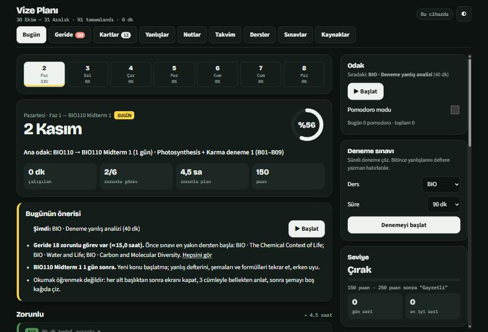
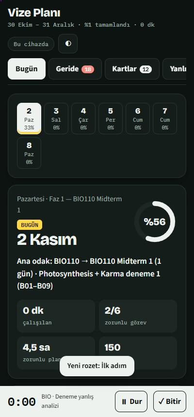
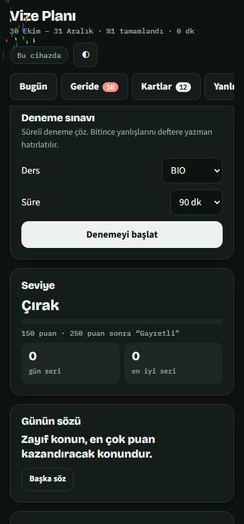

# Vize & Final Planı — 14 haftalık akademik başarı sistemi

Bilgisayar Mühendisliği 2026 Güz dönemi için, **30 Ekim – 31 Aralık 2026** arasını (dönemin 5.–14. haftaları) gün gün planlayan ve her gün **ne, nereden, nasıl** çalışacağını gösteren kişisel çalışma sistemi. Telefondan ve bilgisayardan açılan bir takip sitesi, yazdırılabilir planlar, takvim dosyaları ve Excel takipçisi içerir.

> **Canlı site:** **https://beratergun.github.io/vize-plani/** &nbsp;·&nbsp; Telefonda tarayıcıdan aç, "Ana ekrana ekle" ile uygulama gibi kullan.

<p align="center">
  
  &nbsp;
  
  &nbsp;
  
</p>

## Bu ne için?
Altı derste (BIO110, CMPE371, CMPE327, CMPE421, CMPE453, CMPE499) aynı anda sınav, quiz, ödev ve teslim yetiştirmek için **ne zaman neyi çalışacağını** bilmek. Plan; sınava kalan süreyi, dersin zorluğunu, not ağırlığını ve konuların birbirine bağımlılığını hesaba katar. Hiçbir önbilgi varsayılmaz: konular sıfırdan, kolaydan zora öğretilir. Garanti verilmez; amaç, AA hedefine hizmet edecek düzenli ve ölçülebilir bir çalışma düzeni kurmaktır.

## Öne çıkan özellikler
| Alan | Ne yapar |
|---|---|
| **Günlük plan** | 63 gün, 434 görev. Her günde *zorunlu* (≈3–5 saat) ve *istersen* (ekstra) görevler. Pazar günleri daha uzun kapasiteyle planlı. |
| **Görev kartı** | Ne yapacağın, ana ve destek kaynak, adım adım yöntem, soru hedefi, "bitti sayılır" ölçütü. |
| **Kaynaklar** | Her konu için OpenStax, MIT OCW, Stanford CS103, Berkeley CS188, CS50 AI, ATmega328P veri sayfası gibi doğrulanmış bağlantılar; **141 doğrulanmış YouTube videosu** (başlık, kanal, süre) ve konuya özel arama bağlantıları. |
| **Kronometre ve Pomodoro** | Görev başına süre tutar; 25/5, 50/10, 15/3 pomodoro modu, mola ve bildirim. |
| **Yaptım / Yapmadım** | Her görev işaretlenir; yapılmayanlar *Geride* sekmesine düşer, günün önerisi buna göre değişir. |
| **Hafıza kartları** | Konu kavramlarından otomatik kartlar; aralıklı tekrar (1, 3, 7, 14, 30 gün). |
| **Yanlış defteri** | Hata türüyle kayıt, 3. ve 7. gün tekrar hatırlatması, hata deseni analizi. |
| **Notlar** | Görev başına ve genel notlar; Claude yanıtlarını kaydetme. |
| **Not hesaplayıcı** | Aldığın puanlardan hedef toplam için kalan bileşenlerde gereken ortalama. |
| **Deneme sınavı modu** | Süreli deneme, 10 dakika kala uyarı, bitince yanlış defterine yönlendirme. |
| **Motivasyon** | Puan, seviye, gün serisi, 17 rozet, günün sözü, tamamlayınca ödül mesajı. |
| **Hatırlatıcılar** | Sabah ve akşam kontrolü (sayfa açıkken) + telefon takvimi için `.ics` dosyaları. |
| **Claude ile çalış** | Her konuyu seviyene göre anlattırma, örnekle, 5 soru, hafıza kartı, sınav gibi sorular. *(claude.ai sürümünde)* |
| **Çıktılar** | Yazdırılabilir PDF'ler, Excel takipçi, iki `.ics` takvimi, Markdown plan. |

## Plan özeti (hafta hafta)
| Hafta | Tarih | Odak | Sınav / teslim |
|---|---|---|---|
| Hafta 5 (kalan) | 30 Ekim – 1 Kasım | **BIO**: The Chemical Context of Life; Water and Life · **SİNYAL**: Önkoşul: karmaşık sayılar ve Euler; Önkoşul: trigonometri, üstel, türe · **OTOMAT**: Central concepts + mathematical pr; DFA | — |
| Hafta 6 | 2 Kasım – 8 Kasım | **BIO**: Photosynthesis · **SİNYAL**: Sinusoids; Special signals · **OTOMAT**: NFA ve ε-NFA; DFA ≡ NFA (altküme yapısı) · **YZ**: Intro to AI + intelligent agents; Problem solving + uninformed searc · **MİKRO**: Course overview + ATmega328P archi; Programming AVR (C + bit işlemleri · **STAJ**: Rapor: yönerge + içerik planı; Rapor: taslak 1 | BIO110 Midterm 1; CMPE371 HW1 |
| Hafta 7 | 9 Kasım – 15 Kasım | **BIO**: The Cell Cycle and Cellular Reprod; Mendel and the Gene Idea · **SİNYAL**: CTFT · **OTOMAT**: Myhill–Nerode; Derivatives + regex denkliği · **YZ**: CSP; Planning · **MİKRO**: SPI ve I2C; ADC · **STAJ**: Rapor: taslak 2; Rapor: taslak 3 | CMPE453 Midterm; CMPE327 Midterm |
| Hafta 8 | 16 Kasım – 22 Kasım | **BIO**: Molecular Basis of Inheritance; Gene Expression: Gene to Protein · **MİKRO**: Timers/counters · **STAJ**: Rapor: format + kaynakça; Rapor: son okuma + PDF | CMPE421 Midterm; CMPE499 Summer Training Report |
| Hafta 9 | 23 Kasım – 29 Kasım | **BIO**: Proje: konu seçimi; Descent with Modification · **SİNYAL**: DTFS; DTFT · **OTOMAT**: Chomsky Normal Form; CYK algoritması · **YZ**: ML fundamentals · **MİKRO**: PWM (AVR) · **STAJ**: Video: düzenleme; Video: kalite kontrolü | CMPE499 Summer Training Video; BIO110 Midterm 2; CMPE371 Midterm |
| Hafta 10 | 30 Kasım – 6 Aralık | **BIO**: Proje: 15–20 slayt iskeleti; The Evolution of Populations · **SİNYAL**: Filtering · **OTOMAT**: Pumping lemma + non-regularity; Pushdown automata · **YZ**: Classification and regression; Neural networks and deep learning · **MİKRO**: ARM Cortex / STM32 Discovery temel; STM32 GPIO + LED | — |
| Hafta 11 | 7 Aralık – 13 Aralık | **SİNYAL**: Sampling; Z-Transform · **OTOMAT**: Turing machines; Decision problems · **YZ**: Reinforcement learning; Ethics, explainability, responsibl · **MİKRO**: PWM for ARM Cortex · **Final hazırlığı** (BIO, SİNYAL, OTOMAT, YZ, MİKRO): kümülatif tekrar, süreli karma deneme, yanlış defteri turu, son tur özet | CMPE371 Quiz 1; BIO110 Proje sunumları |
| Hafta 12 | 14 Aralık – 20 Aralık | **Final hazırlığı** (BIO, SİNYAL, OTOMAT, YZ, MİKRO): kümülatif tekrar, süreli karma deneme, yanlış defteri turu, son tur özet | CMPE327 Quiz-2; BIO110 Proje sunumları |
| Hafta 13 | 21 Aralık – 27 Aralık | **Final hazırlığı** (BIO, SİNYAL, OTOMAT, YZ, MİKRO): kümülatif tekrar, süreli karma deneme, yanlış defteri turu, son tur özet | BIO110 Proje sunumları |
| Hafta 14 | 28 Aralık – 31 Aralık | **Final hazırlığı** (BIO, SİNYAL, OTOMAT, YZ, MİKRO): kümülatif tekrar, süreli karma deneme, yanlış defteri turu, son tur özet | BIO110 Proje sunumları |

Final sınavları W14 sonrasıdır; tarihleri hiçbir derste duyurulmadığı için **uydurulmadı**. Duyurulunca `08_Scripts/plan_data.py` içine eklenip plan yeniden üretilir.

## Sınav ve teslim takvimi
| Tarih | Olay | Durum |
|---|---|---|
| 3 Kasım | BIO110 Midterm 1 | Kullanıcı teyitli |
| 6 Kasım | CMPE371 HW1 (2–6 Kas haftası) | Teyit bekliyor |
| 12 Kasım · 18:00–20:00 | CMPE453 Midterm | Kesin (syllabus) |
| 15 Kasım | CMPE327 Midterm (15 Kasım) | Kullanıcı teyitli |
| 20 Kasım | CMPE421 Midterm (20 Kasım) | Kullanıcı teyitli |
| 22 Kasım | CMPE499 Summer Training Report (STR) | Kesin (syllabus) |
| 23 Kasım – 27 Kasım | CMPE371 Midterm (23–27 Kas haftası) | Teyit bekliyor |
| 26 Kasım – 27 Kasım | BIO110 Midterm 2 (26/27 Kas) | Teyit bekliyor |
| 29 Kasım | CMPE499 Summer Training Video | Kesin (syllabus) |
| 7 Aralık – 11 Aralık | CMPE371 Quiz 1 (7–11 Ara haftası) | Teyit bekliyor |
| 10 Aralık – 31 Aralık | BIO110 Proje sunumları (10–31 Ara) | Teyit bekliyor (aralık) |
| 14 Aralık – 18 Aralık | CMPE327 Quiz-2 (14–18 Ara haftası) | Teyit bekliyor |

*Teyit bekleyen tarihler* yalnızca syllabus haftası biliniyor demektir; kesinleşince güncellenir.

## Dersler
| Ders | Ad | Zorluk | Çalışma yaklaşımı |
|---|---|---|---|
| **BIO110** | Introduction to Modern Biology | ●●●○○ | Kavram → şema → karşılaştırma tablosu → aktif hatırlama (flashcard) → konu testi |
| **CMPE371** | Signals and Systems | ●●●●● | Önkoşul → çözümlü örnek → kolaydan zora problem (çözüme bakmadan) → yanlış analizi |
| **CMPE327** | Automata / Theory of Computation | ●●●●○ | Otomat çizme → örnek/karşı örnek üretme → dönüşüm algoritmaları → kısa ispat yazma |
| **CMPE421** | Artificial Intelligence | ●●●●○ | Algoritmayı elle yürüt (arama ağacı, tablo) → karşılaştır → küçük Python deneyi (opsiyonel) |
| **CMPE453** | Microprocessors (ATmega328P / STM32) | ●●●●○ | Register haritası → bit işlemleri → kod okuma/yazma (kağıt üstünde) → davranış yorumlama |
| **CMPE499** | Summer Training (rapor + video) | ●●○○○ | Taslak → revizyon → format/kaynakça kontrolü → erken teslim |

## Haftalık konu haritası (syllabus)
Her dersin 14 haftalık konu akışı (Hafta 1 = 28 Eylül) sitede **Dersler** sekmesinde, `00_Analysis/COURSE_ANALYSIS.md` içinde ve ayrıntılı PDF'in son sayfalarında bulunur. Site ayrıca Bugün sekmesinde "bu hafta derslerde ne işleniyor" kartını gösterir.

| Ders | Haftalık akış (kısa) |
|---|---|
| BIO110 | H2 kimya/su/karbon · H3 makromolekül, hücre, zar · H4 metabolizma, solunum, fotosentez · H6 Midterm 1 · H7 hücre döngüsü, Mendel, kalıtım, DNA · H8 gen ifadesi, biyoteknoloji · H9 Midterm 2 · H10 evrim · H11–14 proje sunumları |
| CMPE371 | H1 giriş · H2 sinüzoidler · H3 özel sinyaller, sistem özellikleri · H4–5 LTI · H6 diferansiyel/fark denklemleri · H7 CTFS · H8 CTFT · H9 Midterm · H10 DTFS · H11 DTFT · H12 filtreleme · H13 örnekleme · H14 Z dönüşümü |
| CMPE327 | H1–2 temeller, DFA · H3–4 NFA, DFA–NFA denkliği · H5–7 düzenli ifadeler, minimizasyon, Myhill–Nerode · H8 CFG · H9–10 CNF, CYK, pumping · H11–12 PDA, Ogden · H13–14 Turing makineleri |
| CMPE421 | H1–2 ajanlar · H3–4 arama · H5–6 oyun, CSP · H7 planlama · H8 bilgi gösterimi · H9 belirsizlik · H10 ML temelleri · H11 sinir ağları · H12 NLP/LLM · H13 pekiştirmeli öğrenme · H14 etik |
| CMPE453 | H1 AVR mimarisi · H2–4 programlama, G/Ç · H5 USART · H6 SPI, I2C · H7 ADC · H8 kesmeler · H9 zamanlayıcılar · H10 PWM · H11–13 ARM Cortex / STM32 |

Her öğrenme bloğunda ayrıca **2 örnek soru ve cevap** (toplam 166) bulunur; sitede cevabı gizli açılır ve "Yanlış yaptım → deftere ekle" ile yanlış defterine kaydolur. Sorular konuya göre yazılmış özgün alıştırmalardır, hocanın soruları değildir.

## Okul bağlantıları (TEDU LMS)
Sitenin sağ üstündeki **TEDU LMS** düğmesi ve Kaynaklar sekmesindeki "Okul / TEDU LMS" kartı şunlara götürür: [LMS](https://lms.tedu.edu.tr/), [LMS giriş](https://lms.tedu.edu.tr/login/index.php), [MyTEDU](https://my.tedu.edu.tr/), [TED Üniversitesi](https://www.tedu.edu.tr/). Giriş bilgisi bu projede saklanmaz.

## Nasıl kullanılır?
1. **Siteyi aç:** https://beratergun.github.io/vize-plani/ — her gün **Bugün** sekmesi o günün görevlerini gösterir.
2. **Çalış:** Görevde **▶ Başlat** ile sayacı aç, bitince **✓ Yaptım** de. Yapamadığını **✗ Yapmadım** işaretle.
3. **Tekrar et:** Her sabah **Kartlar** sekmesindeki kartlara bak; yanlışlarını **Yanlışlar** sekmesine yaz.
4. **Hatırlatma al:** Telefon takvimine `Study_Plan_2026.ics` ve `Exams_Deadlines_2026.ics` dosyalarını ekle (aşağıdaki not).
5. **Geride kaldıysan** ertesi güne yığma; yalnızca zorunlu görevleri yap, sonra planı güncelle (`REPLAN_GUIDE.md`).

### Takvim dosyaları
[`Study_Plan_2026.ics`](Study_Plan_2026.ics) günlük görevleri, [`Exams_Deadlines_2026.ics`](Exams_Deadlines_2026.ics) sınav ve teslimleri tüm gün etkinliği olarak ekler (sabah 08:00 hatırlatma; sınavlar için 7/3/1 gün önce). Telefonda dosyayı açıp takvim uygulamasıyla içe aktar. Sabit UID kullanıldığı için güncel dosyayı tekrar içe aktarmak etkinlikleri günceller, çoğaltmaz. Kendi takvimini bozmamak için önce yeni bir takvim olarak içe aktarmanı öneririm.

### İlerleme nerede saklanır?
* **GitHub Pages sürümü:** ilerleme o tarayıcıda saklanır. Telefon ile bilgisayarı eşlemek için *Kaynaklar → Cihazlar arası aktarım* bölümündeki kodu kopyala/yapıştır.
* **claude.ai sürümü:** aynı hesapla açılınca telefon ve bilgisayar anlık eşleşir; konuları Claude'a anlattırma özelliği de yalnızca orada çalışır.

## Depo yapısı
```
index.html                 Takip sitesi (GitHub Pages bunu yayınlar)
Study_Plan_2026.ics        Günlük plan takvimi
Exams_Deadlines_2026.ics   Sınav ve teslim takvimi
00_Analysis/               Syllabus çıkarımı ve ders analizi
01_Master_Plan/            plan.json (tek kaynak) + MASTER_STUDY_PLAN.md (gün gün plan)
02_Daily_Study/            Haftalık Markdown planlar
03_Course_Plans/           Ders ders görev listeleri
04_Calendar/               .ics takvim dosyaları
05_Printable_PDF/          SADE_PLAN (hafta başı 1 sayfa) ve ayrıntılı PDF
06_Progress_Tracker/       Excel takipçi ve slayt kapsama matrisi
07_Sources/                Kaynak stratejisi
08_Scripts/                Planı, PDF/Excel/ICS çıktılarını ve siteyi üreten Python betikleri
09_Quality_Assurance/      Doğrulama raporu
10_Website/                Site kaynağı ve ekran görüntüleri
```

## Planı kendi bilgilerinle güncelle
Her şey tek bir kaynaktan üretilir: `08_Scripts/plan_data.py` (dersler, sınavlar, konu blokları, günlük program). Python 3.12 yeterlidir; ek paket gerekmez. PDF için Microsoft Edge veya Chrome gerekir.
```bash
cd 08_Scripts
py build_all.py --regen   # plan_data.py'den planı baştan kurar; ICS, XLSX, PDF, MD ve siteyi yeniden üretir
py validate.py            # otomatik kalite kontrolleri (VALIDATION_REPORT.md'yi yazar)
py replan.py --today 2026-11-05          # kaçırılan görevleri taşıma önizlemesi (--apply ile uygular)
py curate_videos.py       # eksik konular için doğrulanmış video arar
```
Sınav tarihi değişince `plan_data.py` içindeki `EVALS` satırını düzenleyip `build_all.py --regen` çalıştırman yeterli. Ayrıntı: [`REPLAN_GUIDE.md`](REPLAN_GUIDE.md).

## Doğrulama ve sınırlar
* Otomatik kontroller (`validate.py`): her takvim günü mevcut, her syllabus konusu planda, her blok bir kez programlı, takvim dosyası yapısı, sınav tarihleri ve etiketleri, site verisi = plan, **site bağlantılarının hepsi açılıyor ve 141 videonun hepsi YouTube'da doğrulandı**.
* **Doğrulanamayanlar:** vize kapsamları syllabus'tan tahmindir (hocadan teyit edilmeli); teyit bekleyen sınav günleri; Khan Academy sayfalarının içeriği (bot korumalı); Excel formülleri Excel'de hesaplanmadı; iki cihazda anlık eşleşme ve telefon bildirimleri gerçek cihazlarda denenmedi.
* **Slayt/ders notu yok:** hiç slayt paylaşılmadığı için "Hocanın materyali" satırlarında sayfa aralığı bulunmaz; slaytlar eklenince kapsama matrisi güncellenir.
* Saatler taahhüt değil tahmindir; Cumartesi kapasitesi bildirilmediği için 3–6 saat varsayılmıştır.

## Kaynaklar ve telif
Bu depo yalnızca plan, bağlantı ve kendi yazdığım çalışma yöntemlerini içerir; **ders içeriği, video veya kitap kopyalanmamıştır**. Bağlantılar OpenStax Biology 2e, MIT OpenCourseWare, Stanford CS103, UC Berkeley CS188, Harvard CS50 AI, Khan Academy, Microchip ve YouTube kanallarının (Amoeba Sisters, Neso Academy, Easy Theory, 3Blue1Brown, Computerphile ve diğerleri) herkese açık sayfalarına gider; içerik hakları sahiplerine aittir.

---
*Hazırlanma: 2026-10-29 · Kişisel çalışma planı; kendi derslerine uyarlayabilirsin.*
